# Onboarding

Before the stateflow of a training starts, TrainAR takes the trainee through the same steps in every training: choosing the training, an introduction to it, a short onboarding on the interaction concept, and placing the training in the surroundings. Authors do not have to build any of this. It is part of the framework and uses the name, description, expert and preview of the training (see [Managing Trainings](Trainings.md)). When the trainee has placed the training, the [Start Training Node](StartTrainingNode.md) starts the stateflow.

## 1. Home screen and introduction

| Home screen | Introduction of the training |
| :---: | :---: |
| 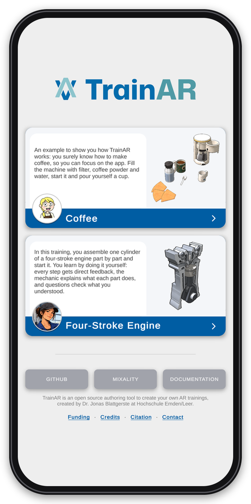 | 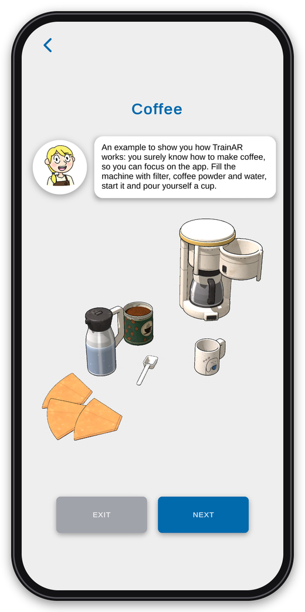 |
| The trainee chooses a training. | The expert introduces the training with its description; below is the preview of its setup, rendered automatically before every build. |

## 2. The interaction concept

Five short pages explain how trainees interact with TrainAR trainings, each with an animation, and every page is read aloud. Trainees can skip them on the first of these pages.

| Instructions at the top | Interact | Grab |
| :---: | :---: | :---: |
| 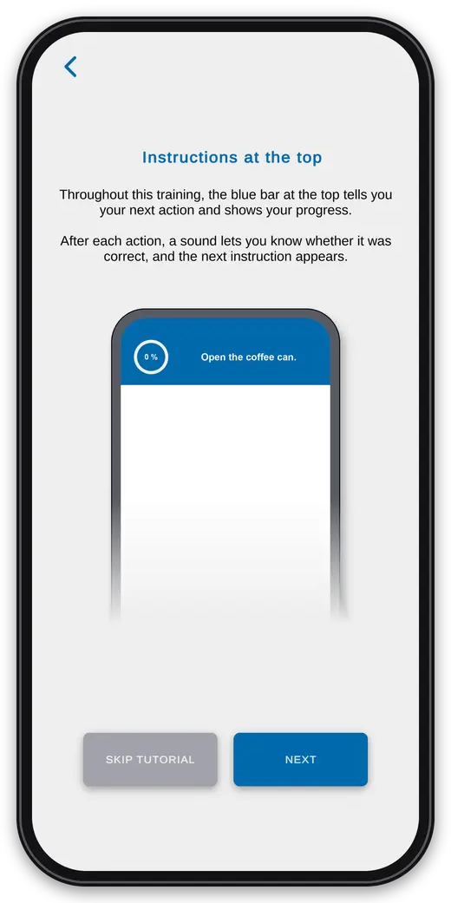 | 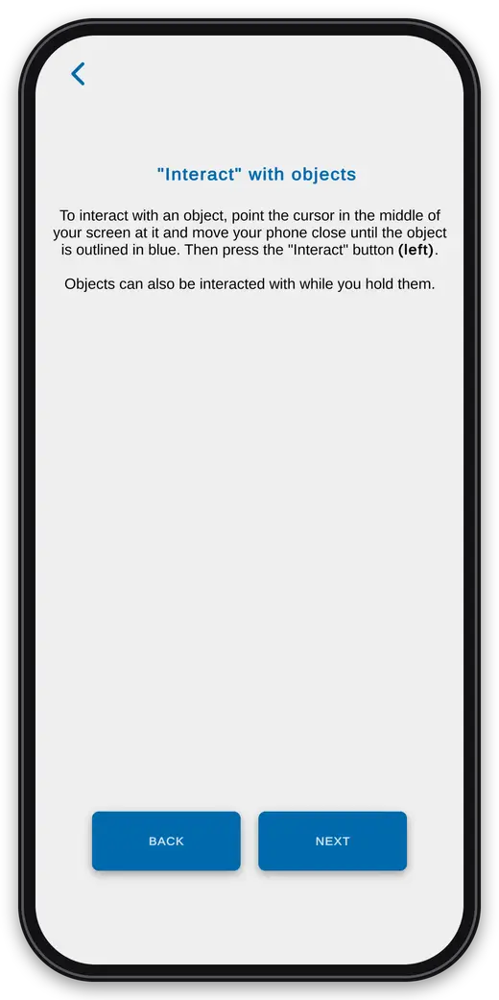 | 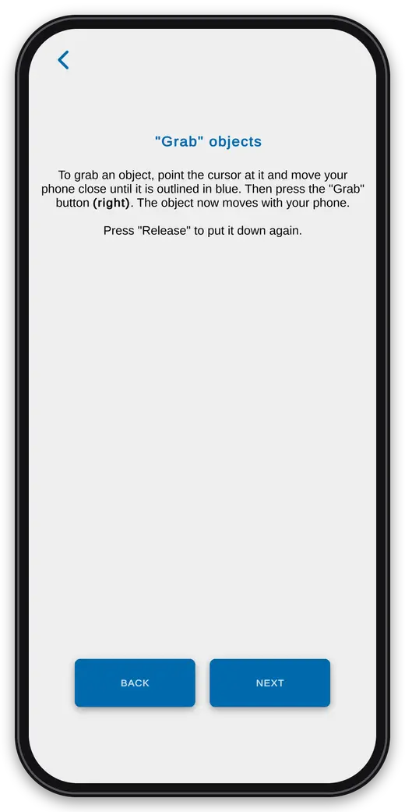 |
| The blue bar at the top tells the trainee the next action and shows the progress. A sound tells whether an action was correct. | Point the cursor at an object and move the phone close until it is outlined in blue, then press **Interact**. | The same, then press **Grab**: the object moves with the phone until **Release** is pressed. |

| Combine | Insights and feedback |
| :---: | :---: |
| 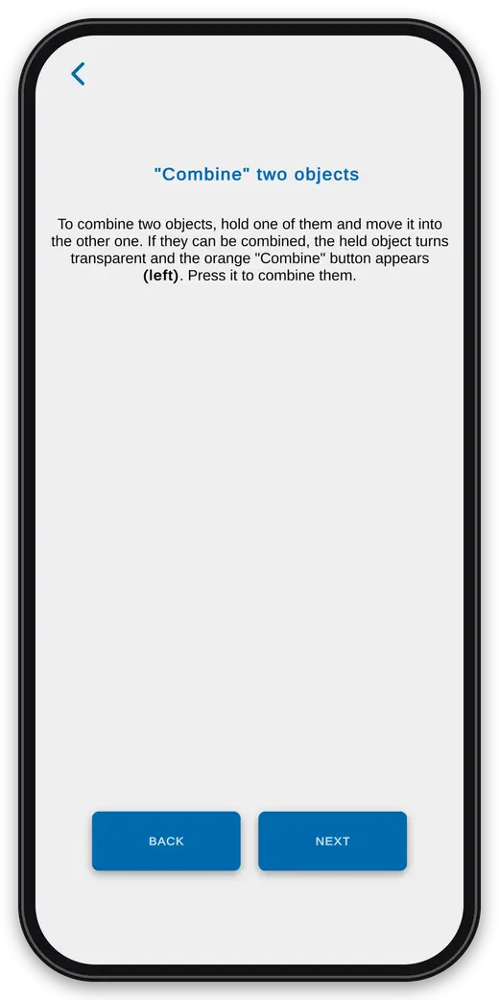 | 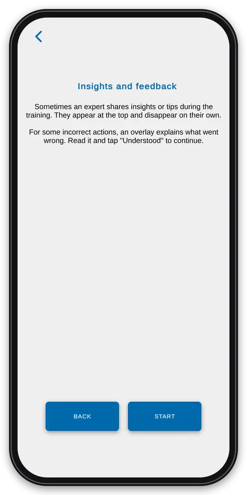 |
| Move a held object into another one: if they can be combined, it turns transparent and **Combine** appears. | The expert shares insights at the top, and for some incorrect actions an overlay explains what went wrong until **Understood** is tapped. |

## 3. Scanning and placing

| Scanning | Placing |
| :---: | :---: |
| 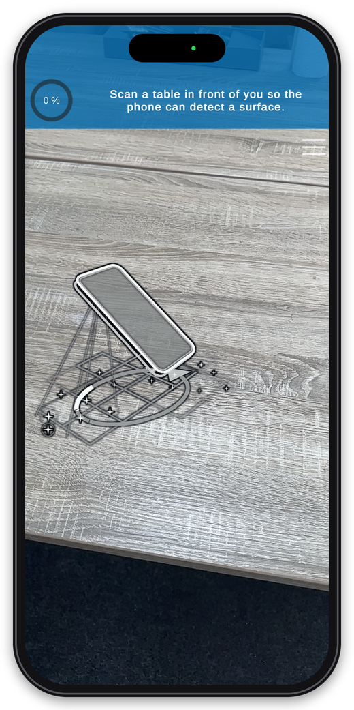 | 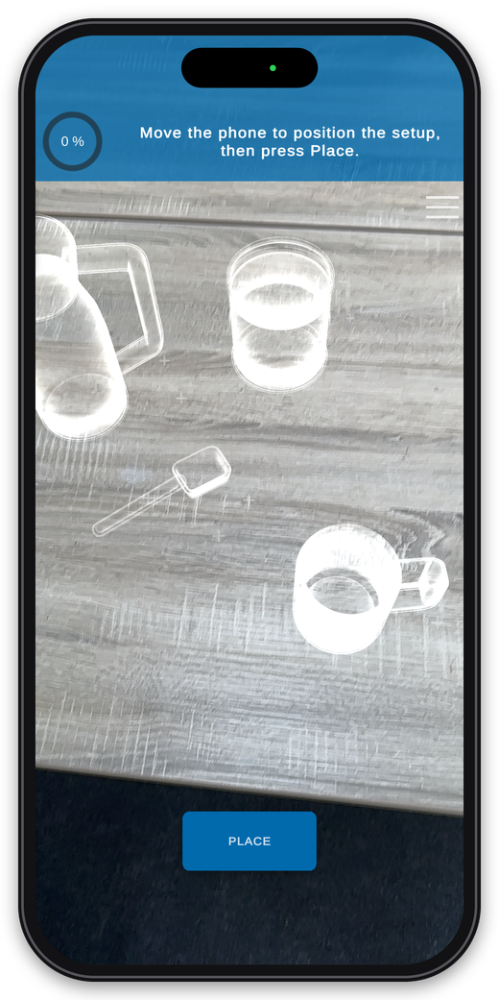 |
| The trainee moves the phone over a table until a surface is detected. | A see-through preview of the setup follows the phone; **Place** puts it down. Now the stateflow of the training starts. |

## 4. During the training: tracking warnings

If the phone loses track of its surroundings during the training, TrainAR dims the screen and shows what the trainee can do about it. This happens automatically, and the training continues as soon as tracking works again.

| Too dark | Too few features | Too much motion |
| :---: | :---: | :---: |
| 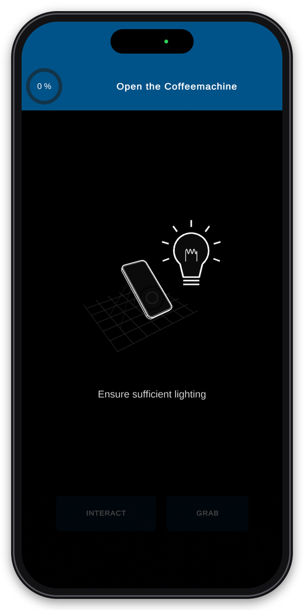 | 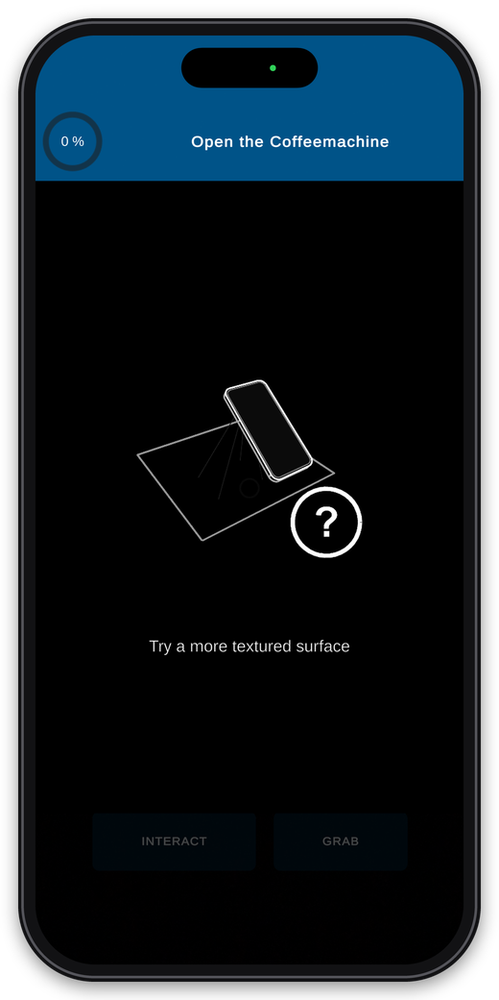 | 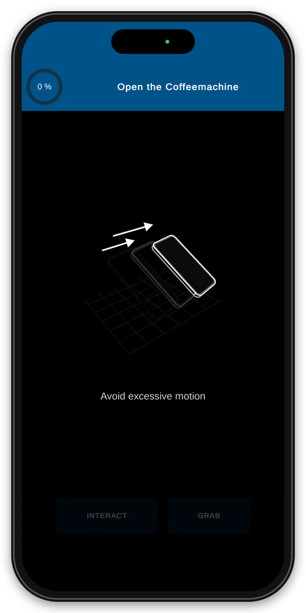 |

