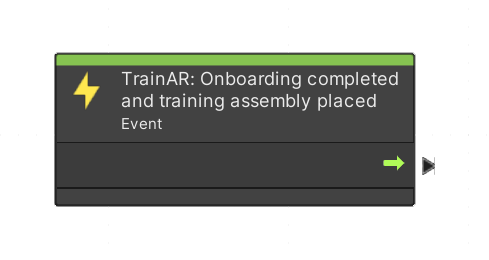
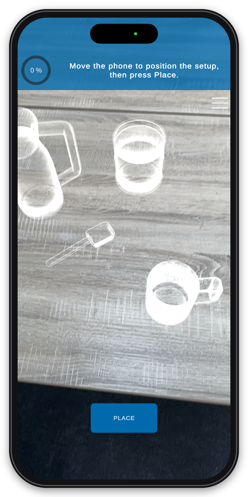

# Start Training Node

The (green) Visual Scripting node called **TrainAR: Onboarding completed and training assembly placed** is an event node that is automatically executed when the user of the training went through the onboarding (the start pages explaining the interaction concept, read aloud), scanned a surface and placed the training assembly with the **Place** button. It acts as a starting point for a TrainAR training created by the author.

> [!IMPORTANT]
> There should be only one **TrainAR: Onboarding completed and training assembly placed** node present in a TrainAR Stateflow.

> [!NOTE]
> While all other TrainAR nodes can be found under Right Click → **TrainAR**, the starting node is located under Right Click → **Events**.

| TrainAR Node | Result |
| :----------------------: |:-------------------------:|
|||

Before this node is executed, the trainee goes through the same steps in every training: choosing the training on the home screen, its introduction, the onboarding on the interaction concept, and scanning and placing. See [Onboarding](Onboarding.md).
