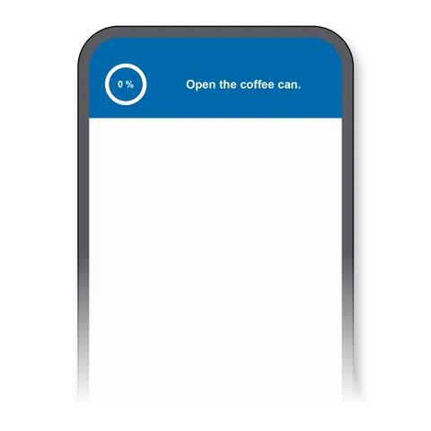
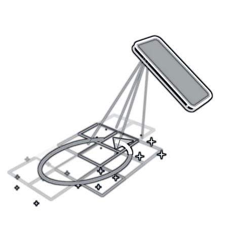

# Start Training Node

The (green) Visual Scripting node called **TrainAR: Onboarding completed and training assembly placed** is an event node that is automatically executed when the user of the training went through the onboarding (the start pages explaining the interaction concept, read aloud), scanned a surface and placed the training assembly with the **Place** button. It acts as a starting point for a TrainAR training created by the author.

> [!IMPORTANT]
> There should be only one **TrainAR: Onboarding completed and training assembly placed** node present in a TrainAR Stateflow.

> [!NOTE]
> While all other TrainAR nodes can be found under Right Click → **TrainAR**, the starting node is located under Right Click → **Events**.

| TrainAR Node | Result |
| :----------------------: |:-------------------------:|
|||

## What happens before this node

Before the stateflow starts, TrainAR takes the trainee through the same steps in every training. Authors do not have to build any of this: it is part of the framework and uses the name, description and expert of the training (see [Managing Trainings](Trainings.md)).

### 1. Home screen and start page

The trainee chooses the training on the home screen. The first page presents it: the expert introduces the training with its description, and below it is the preview of the training's setup, which TrainAR renders automatically before every build.

### 2. Onboarding

Five short pages explain the interaction concept, each with an animation, and every page is read aloud. Trainees can skip the onboarding on its second page.

| Page | What it explains |
| :--- | :--- |
|  | **Instructions at the top**: the blue bar at the top tells the trainee the next action and shows the progress. A sound tells whether an action was correct. |
|  | **Interact**: point the cursor at an object and move the phone close until it is outlined in blue, then press **Interact**. |
|  | **Grab**: the same, then press **Grab**; the object moves with the phone until **Release** is pressed. |
|  | **Combine**: move a held object into another one; if they can be combined, it turns transparent and **Combine** appears. |
|  | **Insights and feedback**: the expert shares insights at the top, and for some incorrect actions an overlay explains what went wrong until **Understood** is tapped. |

### 3. Scanning and placing

The trainee moves the phone over a table until it is detected, then places the training's setup with the **Place** button. Now this node is executed and the stateflow of the training starts.
